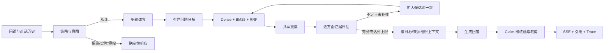

# Blog RAG Search Backend

面向个人知识库的受控 Agentic RAG 后端。它不只“检索后生成”，还会改写多轮问题、拆解复杂问题、检查逐方面证据，并在输出前删除无依据陈述。

> 面试发布版已收口。最终评测见 [docs/FINAL_EVALUATION.md](docs/FINAL_EVALUATION.md)，3～5 分钟演示见 [docs/DEMO_GUIDE.md](docs/DEMO_GUIDE.md)。

## 核心能力与架构

- 安全策略与意图快路：提示词注入、越权、实时问题在模型调用前确定性短路。
- 多轮改写与有界规划：复杂问题最多执行固定轮次和固定数量的子查询。
- 文档感知混合检索：Dense + BM25，经 RRF 融合和本地 cross-encoder 重排。
- 证据闭环：逐子问题判断充分性，不足时只允许一次扩大候选池补救。
- 回答落地：按目标和来源组织上下文，生成后做 claim 级核验与裁剪。
- 可观测性：返回检索轮次、证据状态、补救动作、最终决策等 trace。



- 后端：FastAPI（systemd 托管，Nginx 反代）
- 向量库：本地 Faiss（自托管，零网络，2048 维，内积=余弦）
- Embedding：智谱 embedding-3 / 生成：DeepSeek-chat / 意图分类：glm-4-flash
- 重排：bge-reranker-base ONNX int8 量化，CPU 本地推理，无网络依赖
- 检索：Dense + BM25 (jieba) → RRF(k=60) 融合 → cross-encoder 重排
- 前端：原生 JS，按 stage/sources/token/done 四类 SSE 事件增量渲染

---

## 1. 快速启动

前置条件：Python 3.11、可用的智谱和 DeepSeek API Key，以及已生成的 `data/vector_store.faiss` 和 `data/vector_store_meta.json`。首次没有索引时，先按“入库”章节构建。

```bash
python -m venv .venv
# Windows PowerShell: .\.venv\Scripts\Activate.ps1
# macOS/Linux: source .venv/bin/activate
pip install -r requirements-dev.txt
# Windows: Copy-Item .env.example .env
# macOS/Linux: cp .env.example .env
# 编辑 .env，填入 ZHIPU_API_KEY 与 DEEPSEEK_API_KEY
python -m uvicorn api.serve:app --reload --port 8000
```

健康检查与搜索：

```bash
curl http://localhost:8000/health
curl -X POST http://localhost:8000/search \
  -H "Content-Type: application/json" \
  -H "x-api-key: $API_KEY" \
  -d '{"query":"如何部署博客","top_k":5}'
```

`API_KEY` 为空时可省略请求头。密钥只接受 `x-api-key` / `x-admin-token` 请求头，禁止放在 URL 查询参数中。

### 流式搜索

`POST /search/stream` 通过 `text/event-stream` 推送事件，顺序为：

| 事件 | 含义 |
|------|------|
| `stage` | 当前阶段（routing / retrieving / generating / verifying） |
| `sources` | 引用列表 + 回答模式 |
| `token` | 逐 token 答案文本 |
| `done` | 完整 `SearchResponse`（含 answer、citations、mode） |

---

## 2. 入库

把 Hexo **源码仓**（Markdown + PDF）灌进本地 Faiss：
Faiss是用于高效相似性搜索和稠密向量聚类的算法库，不是数据库，无法提供数据持久化，CRUD操作，元数据过滤和权限管理等，通过索引和压缩解决高维空间下暴力搜索速度过慢的问题。
持久化：faiss.write_index() 生成的 .bin 文件
数据加载：faiss.read_index() 读到内存
增删改查：修改元数据表，向量库需重建

```bash
# 全量重建
python -m api.ingest --repo D:/Blog --recreate

# 增量：只 embed 变更的 slug
python -m api.ingest --repo D:/Blog --incremental

# 增量 + LLM 自动生成文章摘要（缺失才调用）
python -m api.ingest --repo D:/Blog --incremental --summarize
```

- Markdown 解析 frontmatter 构造 URL；PDF 抽取文本（fitz）
- 幂等 upsert：以 `(slug, chunk_index)` 为键合并，已存在则覆盖，可重复运行
- 增量模式按 slug 内容 hash 比对，无变更跳过重嵌

### 线上热重载

无需重启服务即可同步最新文章。`/admin/reload` 会先 `git pull` 博客仓库，再增量入库并刷新 BM25：

```bash
# 直连 uvicorn 无 /api 前缀（root_path 只影响文档 URL）；经 Nginx 则是 /api/admin/reload
# repo 可省略，缺省读配置里的 BLOG_REPO_PATH
curl -X POST http://localhost:8000/admin/reload \
  -H "x-admin-token: $ADMIN_TOKEN" \
  -H "Content-Type: application/json" \
  -d '{"incremental":true,"summarize":true}'
```

### 文章发布 → 自动入库链路

内容真值在 GitHub 博客仓库，向量库真值在服务器。本地只负责写文章并 push，服务器持有一份克隆副本自行入库，**不传二进制索引**。

```
本地写 md ──push──> GitHub 博客仓库 ──Actions──> hexo generate + 部署站点
                                                        │
                                          部署完成后 curl 通知
                                                        v
                          服务器 /admin/reload：git pull → 增量入库 → 刷新 BM25
                                                        ^
                                   cron 每 10 分钟兜底（scripts/sync_blog.sh）
```

**为什么通知放在部署之后**：文章 URL 取自线上 `search.xml`，由 Actions 构建生成。若在部署前入库，新文章会「能检索但没有阅读链接」。等部署完再通知，URL 天然齐全；即使某次早了，URL 变化会让内容 hash 变，下一轮增量自动重嵌补全。

一次性配置：

| 位置 | 配置 |
|------|------|
| 服务器 | `git clone git@github.com:<user>/<blog>.git <博客目录>`（私有仓库用 SSH key；目录任选，与下面 `BLOG_REPO_PATH` 一致即可） |
| 服务器 `.env` | `BLOG_REPO_PATH=<博客目录>` 与 `ADMIN_TOKEN=<令牌>` |
| 服务器 cron | `*/10 * * * * <后端目录>/scripts/sync_blog.sh >> /var/log/rag-sync.log 2>&1` |
| 博客仓库 Secret | `RAG_ADMIN_TOKEN` = 服务器 admin 令牌（Settings → Secrets and variables → Actions） |
| 博客仓库 Variable（可选） | `RAG_API_BASE`，默认 `https://rag.zyydgrbk.top/api` |

`sync_blog.sh` 会自定位后端仓库根目录并读取同级 `.env` 里的 `BLOG_REPO_PATH` / `ADMIN_TOKEN`，**因此 cron 行里不需要写令牌**（写进 crontab 会被 `crontab -l`、`ps` 看到）。需要临时覆盖时，仍可用环境变量：`BLOG_REPO=... BACKEND_URL=... ADMIN_TOKEN=... ./scripts/sync_blog.sh`（优先级：环境变量 > `.env` > 内置默认）。

博客仓库 `.github/workflows/autodeploy.yml` 末尾已加「通知 RAG 增量入库」步骤，标了 `continue-on-error`，通知失败不影响站点部署。

---

## 3. 部署到服务器

### 3.1 基本发布流程（代码更新后）

```bash
# 服务器端
cd /opt/blog-rag-backend
git pull
# 自托管服务器既 serve 又运行 api.ingest 入库，必须安装 dev 依赖集：
# python-frontmatter / pymupdf / pdfplumber 等入库依赖均在 requirements-dev.txt，
# requirements.txt 是 Vercel 最小集，不含这些。漏装会导致入库静默 0 chunk。
.venv/bin/pip install -r requirements-dev.txt   # 依赖无变更时秒过，有变更才真正安装
systemctl restart blog-rag                  # 必须重启：systemd 常驻进程启动即把代码载入内存，git pull 只改磁盘文件
```
systemd 配置实现常驻运行 + 开机自启 + 崩溃自动拉起，Nginx 反向代理转发 `/api/*` 到 `127.0.0.1:8000`。

常用运维命令：

```bash
journalctl -u blog-rag -f     # 实时日志
systemctl status blog-rag     # 运行状态
systemctl restart blog-rag    # 重启
```

### 3.2 备案后上线

国内服务器对外提供 Web 服务前必须完成 **ICP 备案**；备案通过后，才能把域名指向本服务器并启用 HTTPS。本项目的切流链路：

```
用户浏览器 → https://rag.zyydgrbk.top/api/search
                ↓（Cloudflare DNS 仅解析 / 灰云）
            Nginx（监听 443，终止 TLS + 反代）
                ↓
            本机 uvicorn（127.0.0.1:8000，FastAPI，root_path=/api）
```

### 3.3 DNS 托管（Cloudflare）

- 域名 NS 已委派给 Cloudflare（`*.ns.cloudflare.com`），因此**阿里云云解析 DNS 的记录不生效**，所有子域记录都在 Cloudflare 后台添加。
- 添加记录：类型 `A`、名称 `rag`、IPv4 `47.116.188.225`、代理状态 **灰色云朵（仅 DNS）**。
  - 灰色云朵：用户直连阿里云服务器，路径最短、最稳，且符合备案要求。
  - 橙色云朵（代理）：流量先经 Cloudflare 再回源，存在备案合规风险，且可能影响 SSE 流式响应；如坚持使用见 3.5 注。
- 生效验证：`nslookup rag.zyydgrbk.top` 应返回 `47.116.188.225`。
- 阿里云安全组（防火墙）放行 **80 / 443** 入站，否则证书申请与访问都会失败。

### 3.4 Nginx 反代 + HTTPS 证书（certbot）

Nginx 是服务器上独立运行的程序（非 Python 库），角色是 HTTPS 终止 + 反向代理。系统：Ubuntu 24.04。

```bash
# 1. 安装 Nginx + certbot
sudo apt update && sudo apt install -y nginx certbot python3-certbot-nginx

# 2. 删默认站点，写入「引导配置」（仅 80 端口，供 certbot 做 HTTP 验证）
sudo rm -f /etc/nginx/sites-enabled/default
sudo tee /etc/nginx/sites-available/rag.zyydgrbk.top > /dev/null <<'EOF'
server {
    listen 80;
    listen [::]:80;
    server_name rag.zyydgrbk.top;
    location /.well-known/acme-challenge/ { root /var/www/certbot; }
    location /api/ {
        proxy_pass http://127.0.0.1:8000/;
        proxy_http_version 1.1;
        proxy_set_header Host $host;
        proxy_set_header X-Real-IP $remote_addr;
        proxy_set_header X-Forwarded-For $proxy_add_x_forwarded_for;
        proxy_set_header X-Forwarded-Proto $scheme;
        proxy_buffering off;
        proxy_read_timeout 120s;
    }
    location / { return 301 https://$host$request_uri; }
}
EOF
sudo ln -s /etc/nginx/sites-available/rag.zyydgrbk.top /etc/nginx/sites-enabled/
sudo nginx -t && sudo systemctl reload nginx

# 3. 申请 Let's Encrypt 证书（把邮箱换成你自己的）
sudo certbot certonly --nginx -d rag.zyydgrbk.top \
  --non-interactive --agree-tos --email you@example.com --no-eff-email

# 4. 覆盖为「最终配置」（443 + SSL + SSE 关缓冲）
sudo tee /etc/nginx/sites-available/rag.zyydgrbk.top > /dev/null <<'EOF'
server {
    listen 80;
    listen [::]:80;
    server_name rag.zyydgrbk.top;
    location /.well-known/acme-challenge/ { root /var/www/certbot; }
    location / { return 301 https://$host$request_uri; }
}
server {
    listen 443 ssl;
    listen [::]:443 ssl;
    server_name rag.zyydgrbk.top;
    ssl_certificate     /etc/letsencrypt/live/rag.zyydgrbk.top/fullchain.pem;
    ssl_certificate_key /etc/letsencrypt/live/rag.zyydgrbk.top/privkey.pem;
    include /etc/letsencrypt/options-ssl-nginx.conf;
    ssl_dhparam /etc/letsencrypt/ssl-dhparams.pem;
    add_header Strict-Transport-Security "max-age=31536000" always;
    location /api/ {
        proxy_pass http://127.0.0.1:8000/;
        proxy_http_version 1.1;
        proxy_set_header Host $host;
        proxy_set_header X-Real-IP $remote_addr;
        proxy_set_header X-Forwarded-For $proxy_add_x_forwarded_for;
        proxy_set_header X-Forwarded-Proto $scheme;
        proxy_buffering off;
        proxy_cache off;
        proxy_set_header Connection "";
        chunked_transfer_encoding on;
        proxy_read_timeout 120s;
        proxy_connect_timeout 10s;
    }
}
EOF
sudo nginx -t && sudo systemctl reload nginx
```

### 3.5 验证与收尾

```bash
curl https://rag.zyydgrbk.top/api/health            # 应返回 {"status":"ok"}（证书受信任，无需 -k）
curl -k -X POST https://rag.zyydgrbk.top/api/search \
  -H "Content-Type: application/json" -d '{"query":"你的博客是怎么搭建的","top_k":3}'
```

- 前端 `rag-client.js` 生产端点指向 `https://rag.zyydgrbk.top/api/search`；若博客 `_config.butterfly.yml` 用 `window.RAG_SEARCH_ENDPOINT` 覆盖，**务必带 `/api`**，否则请求落不到 Nginx `/api/` 反代、CORS 预检失败。
- 后端 `API_KEY` 留空即放行（前端不放密钥，靠 CORS + 限流防滥用）；`ALLOWED_ORIGINS` 建议收紧为 `https://zyydgrbk.top,http://localhost:4000`。

---

## 4. 评估

本发布版的冻结结果如下。挑战集用于验证最终的上下文组织和回答核验能力；它与 80 条 Agentic 集的题目分布不同，因此不能作为严格的前后 A/B。

| 数据集 | 样本 / RAGAS 有效样本 | Faithfulness | Answer Relevancy | Context Precision | Context Recall | Factual Correctness |
|------|------:|------:|------:|------:|------:|------:|
| 开发集 | 56 / 45 | 0.7593 | 0.6312 | 0.5409 | 0.5943 | 0.3533 |
| 原始最终集 | 24 / 20 | 0.7305 | 0.5620 | 0.4453 | 0.4533 | 0.2350 |
| 回答质量挑战集 | 12 / 7 | **0.8511** | **0.6413** | **0.7270** | **0.7857** | **0.4400** |

挑战集同时达到：核验成功率 `1.000`、无答案拒答准确率 `1.000`、延迟 p50/p95 `8.345s / 19.470s`。机器可读冻结清单为 `eval/final_evaluation_manifest.json`。

### 底层检索回归（retrieval regression）

历史人工标注集实际为 **49 条**（ID 1～50 中从首次提交起就缺少 ID 25；旧文档所称“50 条”是计数错误）。该文件已通过 SHA-256 指纹冻结，独立于后续 Agentic 扩展题集，只用于发现 dense、hybrid/RRF、rerank 的底层检索退化，不评价多轮改写、问题分解、证据补救或回答质量。

```bash
python -m eval.eval_recall --tag baseline                # 依次运行以下三种模式
python -m eval.eval_recall --mode raw --tag baseline     # 纯向量 baseline
python -m eval.eval_recall --mode hybrid --tag baseline  # 向量 + BM25 (RRF)
python -m eval.eval_recall --mode rerank --tag baseline  # hybrid + cross-encoder 重排
```

指标：Recall@3/5/10/12/50、MRR、分离度和分类诊断。结果记录题集、Faiss 索引和元数据 SHA-256、索引构建时间、embedding/reranker 配置及运行环境，并且只与**同模式**的上一次结果比较；本地无历史结果时使用 `eval/baselines/` 中已提交的基线。完整输出写入 `eval/results/retrieval_regression_*.json`（默认不入 Git）。

**实测数据**（1717 chunk / 87 slug，rerank 模式下取候选池 50）：

| 模式 | R@3 | R@5 | R@10 | MRR |
|------|-----|-----|------|-----|
| raw | 0.592 | 0.633 | 0.694 | 0.564 |
| hybrid | 0.755 | 0.878 | 0.980 | 0.718 |
| rerank | 0.959 | 0.980 | 0.980 | 0.845 |

### 端到端 RAGAS 评估

用生产链路跑完整生成。只有题集期望正常回答、带参考答案，且实际产出了
非 fallback 的 RAG 回答、上下文和 `final_decision=answer` 时，样本才进入
RAGAS；部分回答、拒答、实时数据和安全边界题不混入回答质量分数。

RAGAS 指标包括 Faithfulness、Answer Relevancy、Context Precision、
Context Recall 和 Answer Correctness（具体名称随安装的 RAGAS 版本兼容映射）：

```bash
python -m eval.eval_ragas --split dev --limit 3 --tag smoke
python -m eval.eval_ragas --split dev --tag baseline
python -m eval.dataset_splits
python -m pytest -q
```

结果写入 `eval/results/ragas_results_*.json`，并记录各类跳过原因。旧的
`eval/eval_queries.json` 是 49 条底层检索回归集，没有参考答案，不作为
RAGAS 回答质量题集。

部分回答、拒答、实时数据和安全边界题使用确定性行为断言，分别检查最终决策、
引用、缺口披露和固定拒答/无实时工具回复；结果位于同一报告的 `agentic` 汇总中。

### Agentic 题集分集

  `eval/agentic_eval_queries.json` 是唯一的 Agentic 题库；题目来自 `D:\Blog\source\_posts` 中已发布且已进入当前索引的真实文章，并锁定题库 SHA-256。当前共 80 条，按 56 条开发集 / 24 条最终验证集（70% / 30%）分层冻结。开发集用于调改写、复杂问题门槛、证据阈值和补救候选池；最终验证集在配置冻结前不得查看逐题结果。

```bash
python -m eval.dataset_splits                 # 校验两份冻结分集
python -m eval.eval_ragas --split dev --tag tune-01 --generate-only
python -m eval.eval_ragas --split final --tag final-v1 --generate-only
```

原始 `eval/eval_queries.json` 的底层检索回归集保持完全独立，不能并入这两个集合。

---

## 5. 环境变量速查

| 变量 | 说明 | 默认 |
|------|------|------|
| `FAISS_INDEX_PATH` / `FAISS_META_PATH` | 本地 Faiss 索引与元数据路径 | data/vector_store.* |
| `BLOG_REPO_PATH` | 服务器侧博客仓库克隆路径，`/admin/reload` 缺省从这里 pull 并入库 | — |
| `ZHIPU_API_KEY` | 智谱 API（embedding + 意图分类） | — |
| `DEEPSEEK_API_KEY` | DeepSeek API（生成） | — |
| `ADMIN_TOKEN` | `/admin/reload` 鉴权令牌 | — |
| `EMBED_MODEL` / `EMBED_BASE_URL` / `EMBED_DIM` | Embedding 配置 | embedding-3 / 智谱 / 2048 |
| `GEN_MODEL` / `GEN_BASE_URL` | 生成模型 | deepseek-chat / DeepSeek |
| `RETRIEVAL_CANDIDATE_K` | rerank 候选池大小 | 8 |
| `GENERATION_CONTEXT_K` | 最终送入上下文块数 | 5 |
| `RERANK_RELEVANCE_THRESHOLD` | 普通知识题的站内资料相关性门槛 | 0.15 |
| `EVIDENCE_RELEVANCE_THRESHOLD` | 普通知识题的逐方面证据门槛 | 0.15 |
| `QUANTIFIED_EVIDENCE_RELEVANCE_THRESHOLD` | 数量、收入、QPS 等事实的相关性门槛；仍需直接数值证据 | 0.30 |
| `API_KEY` / `ALLOWED_ORIGINS` / `RATE_LIMIT_PER_MIN` | API 加固 | 关 / * / 10 |
| `RERANK_BACKEND` | 重排后端（local 为 ONNX） | local |
| `WARMUP_ON_START` | 启动时预加载 BM25 + reranker | True |

---

## 6. 已知注意点

- **Embedding 维度**：换模型必须同步改 `EMBED_DIM`，否则检索失败。
- **PDF 无文本层**：需 OCR，当前仅标记占位。
- **缓存**：进程内 lru_cache（query embedding 256 / blog overview 1），多实例不共享。
- **限流**：当前也是进程内实现，多实例部署需要换成 Redis 等共享存储。
- **多轮指代**：类似“这两个指标”的隐式指代仍可能改写不完整。
- **数值缺失判断**：相邻但不相关的数字仍可能造成少量证据充分性误判。
- **延迟**：生成后核验增加一次模型调用；当前挑战集 p95 为 19.470 秒。
- **流式语义**：为避免先输出后撤回，RAG 正文会在核验完成后再发送，`verifying` 阶段不会逐 token 展示未经核验文本。
- **后端不可用时**：前端自动回退到博客本地字符搜索。

受控Agentic RAG：
模型负责理解和判断，程序负责执行边界、动作范围、循环次数和终止条件。
